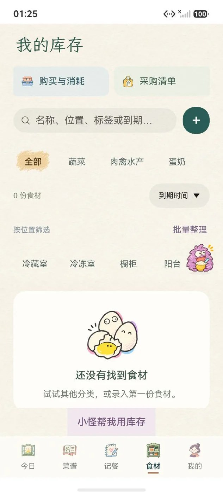
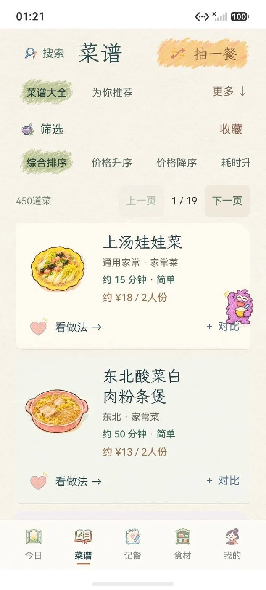
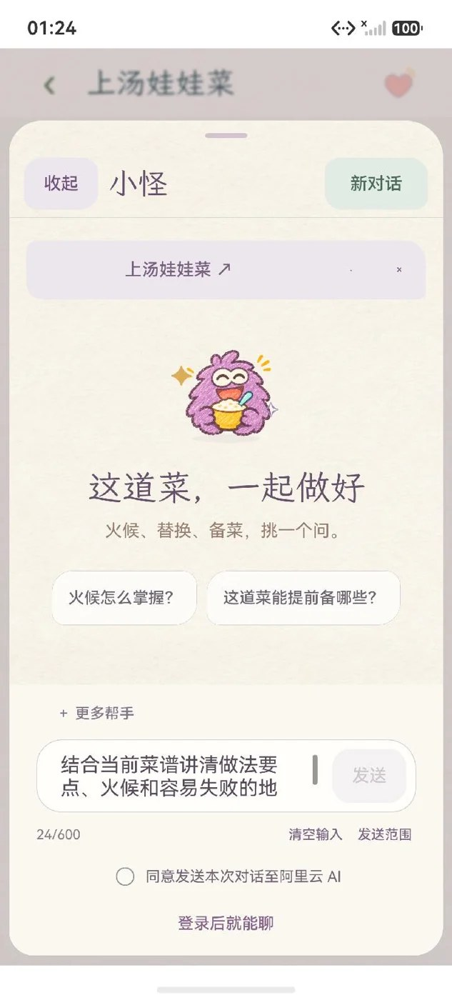

# 开饭小怪

**冰箱里有番茄和鸡蛋，今晚除了番茄炒蛋，还能吃什么？**

把手头的食材记进小怪的食材库，看看 **450 道菜谱**里有哪些能做。想换个吃法，就把「一示例主体、预算 20 元、最好只洗一口锅」告诉 AI 小怪。决定吃什么之后，还可以把这顿饭记下来，下次翻翻自己最常做哪道菜。

[去华为应用市场看看](https://appgallery.huawei.com/app/detail?id=com.shiku.foodkeeper) · [浏览菜谱数据](backend/data/recipes.json) · [申请开发测试服务](https://github.com/Maodii/kaifan-monster/issues/new?template=server-access.yml)

## 今晚怎么用？

| 打开食材库 | 翻翻菜谱 | 问问小怪 |
| :---: | :---: | :---: |
|  |  |  |
| 买回来的食材记在一起，做饭前先看家里有什么。 | 按食材找做法，也可以抽一道菜，让小怪帮你做决定。 | 给出人数、预算和忌口，让小怪设计新菜，再挑要不要存进私房菜。 |

**做完这顿，也可以记下它。** 在家做饭和出门吃饭都能记进饮食记录，还能留一张照片。食材、菜谱和用餐记录支持在本机使用；需要跨设备同步、私有照片备份或云端 AI 时，再连接服务。

## 想看看它是怎么做的？

当前公开源码为 **0.9.37（构建号 55）**，涵盖 HarmonyOS NEXT 和 Android。两端共用菜谱与推荐逻辑，鸿蒙界面使用 ArkTS / ArkUI，Android 使用原生容器承载 Web 界面。

| 你感兴趣的部分 | 从这里开始 |
| --- | --- |
| 一道推荐是怎么算出来的 | [共享推荐逻辑](client/entry/src/main/ets/model/RecommendationCore.ets) · [菜谱数据](backend/data/) |
| 两个平台如何呈现同一个厨房 | [鸿蒙客户端](client/entry/src/main/ets/) · [Android 界面](android/web/) |
| 小怪的模样和厨房里的插画从哪里来 | [角色与美术原稿](art-source/) · [菜谱封面](art-source/recipe-covers/) |
| 如何搭起自己的服务 | [开发者接入指南](docs/developer-access.md) · [NestJS 后端](backend/src/) · [AI 网关](ai-gateway/) |

想改一道菜的推荐规则、打磨某个手机界面，或者给小怪画一个新表情？欢迎在 [Issues](https://github.com/Maodii/kaifan-monster/issues) 说说你遇到的场景。需要联调账号、同步或 AI 的开发者，可以[申请示例主体测试权限](https://github.com/Maodii/kaifan-monster/issues/new?template=server-access.yml)，填写用途、需要的能力和预计测试期限。
